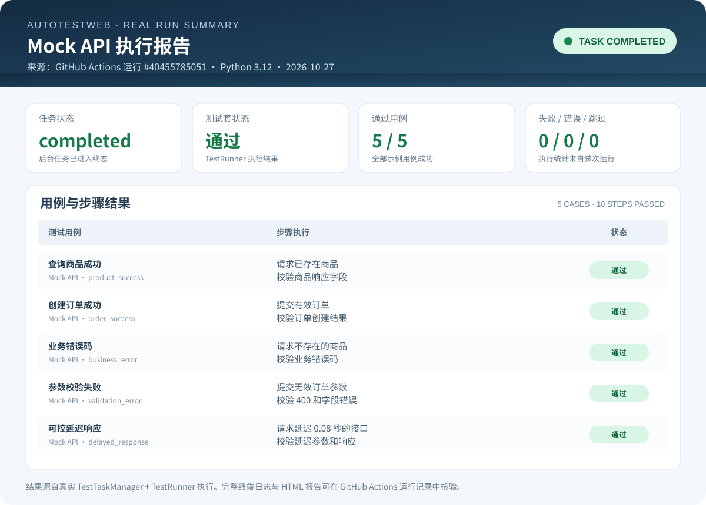
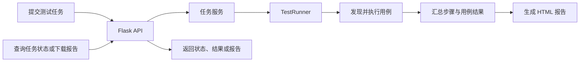

# AutoTestWeb

[](https://github.com/T-tang-tao/AutoTestWeb/actions/workflows/task-lifecycle-tests.yml)

**AutoTestWeb 是一个基于 Python + Flask 的自动化测试工作台。** 它将测试用例发现、步骤执行、任务状态跟踪和 HTML 报告生成串联起来，并提供 HTTP、数据库和配置等公共能力。

仓库同时提供本地 Mock API 演示，无需真实业务账号或 MySQL，就能复现核心执行流程。

## 项目能做什么

| 能力 | 说明 |
| --- | --- |
| **用例执行** | 自动发现测试用例，按定义执行步骤、断言并汇总结果 |
| **任务管理 API** | 提交测试任务，查询任务状态、进度和执行结果 |
| **HTML 测试报告** | 生成任务报告，并通过接口查询或下载 |
| **测试基础设施** | 提供 HTTP、数据库客户端、配置加载和事务处理等公共能力 |
| **自动化质量验证** | 通过 pytest、Ruff 和 GitHub Actions 检查核心行为与回归风险 |

## 先运行 Demo

需要 **Python 3.10 或更高版本**。

### 1. 创建虚拟环境并安装依赖

Windows PowerShell：

```powershell
python -m venv .venv
.\.venv\Scripts\Activate.ps1
python -m pip install -r requirements-dev.txt
```

macOS / Linux：

```bash
python -m venv .venv
source .venv/bin/activate
python -m pip install -r requirements-dev.txt
```

### 2. 启动演示

```bash
python examples/mock_api/run_demo.py
```

Demo 会启动仅供本机访问的临时 Mock API，通过真实的 `TestRunner` 执行 5 个示例用例，输出任务摘要并生成 HTML 报告。正常情况下，摘要如下：

```json
{
  "task_status": "completed",
  "status": "通过",
  "stats": {
    "total": 5,
    "passed": 5,
    "failed": 0,
    "error": 0,
    "skipped": 0
  },
  "report_path": "reports/mock-api-demo-report.html"
}
```

报告默认保存到 `reports/mock-api-demo-report.html`，也可以用 `--report-path` 指定其他位置。

<details>
<summary>查看 Demo 的实际结果截图</summary>



</details>

> **验证边界：** 该 Demo 用于复现框架执行主链路，不代表私有业务系统已经完成集成测试。CI 会在 Python 3.10、3.11 和 3.12 环境中运行该示例，并上传 HTML 报告供检查。

## 执行流程



## 常用 API

新开发的客户端优先使用通用、带版本号的 `/api/v1` 接口。它们不绑定 HuiXin 项目；测试用例路径相对于当前配置中的业务用例根目录。

| 方法 | 路径 | 用途 |
| --- | --- | --- |
| `GET` | `/api/v1/test-cases` | 获取可用测试用例，返回相对路径 |
| `GET` | `/api/v1/config/test-bed` | 查询 TestBed 测试环境配置 |
| `PUT` | `/api/v1/config/test-bed` | 替换 TestBed 测试环境配置 |
| `POST` | `/api/v1/tasks` | 提交指定用例列表，返回任务 ID |
| `GET` | `/api/v1/tasks/<task_id>` | 查询任务状态、进度与执行结果 |
| `GET` | `/api/v1/tasks/<task_id>/report` | 下载任务 HTML 报告 |

### 提交任务示例

```json
{
  "test_cases": [
    {
      "path": "PrisonAssessmentSystem/TestCases/Assessment/InPrison/inmate_assessment_criminal_base_info_01.py",
      "name": "inmate_assessment_criminal_base_info_01"
    }
  ],
  "params": {}
}
```

`test_cases` 是必填的非空数组；每个元素包含相对于业务用例根目录的 Python 文件路径，`name` 可省略。业务参数放在 `params` 对象中。任务提交成功后返回 HTTP 202 和 `task_id`。任务级状态包括 `pending`、`running`、`completed`、`failed` 和 `error`；它们与 TestRunner 内部用例、步骤使用的中文状态不同。

### HuiXin 旧接口兼容

为了不立即破坏现有调用方，旧路径仍可用；新客户端不应再依赖它们。

| 方法 | 旧路径 | 说明 |
| --- | --- | --- |
| `GET` | `/huixin/getConfig` | TestBed 配置读取兼容入口 |
| `POST` | `/huixin/saveConfig` | 旧配置保存入口，保留 HuiXin 用户 ID 兼容处理 |
| `POST` | `/huixin/executeTestCases` | 使用 `assessment` 代码选择 PrisonAssessmentSystem 用例的旧入口 |
| `GET` | `/huixin/getTaskStatus/<task_id>` | 任务状态兼容入口 |
| `GET` | `/huixin/getTaskReport/<task_id>` | HTML 报告下载兼容入口 |
| `POST` | `/huixin/createReport` | PrisonAssessmentSystem 专属业务用例，不属于通用报告下载 API |

任务与配置接口已使用通用路由；只有业务专属的 `createReport` 和旧版评估映射继续放在 HuiXin 兼容层。

## 运行自己的测试环境

如果需要连接真实业务系统，请先安装运行时依赖，并根据自己的测试环境准备配置文件。

```bash
python -m pip install -r requirements.txt
```

Windows PowerShell：

```powershell
Copy-Item configs/main.example.yml configs/main.yml
Copy-Item configs/TestBed.example.yml configs/TestBed.yml
Copy-Item configs/TestSet.example.yml configs/TestSet.yml
```

macOS / Linux：

```bash
cp configs/main.example.yml configs/main.yml
cp configs/TestBed.example.yml configs/TestBed.yml
cp configs/TestSet.example.yml configs/TestSet.yml
```

根据实际环境编辑配置后，启动 Web 服务：

```bash
python server.py
```

默认服务地址为 `http://127.0.0.1:5000`。如果需要运行本地配置的测试集，请在另一个终端执行：

```bash
python -m TestRunner.runner
```

> **安全提示：** 当前服务没有完整的鉴权与访问控制能力。仅应在受控的本地或内网开发环境运行，不要直接暴露到公网。真实环境测试需要获得授权，并使用合适的测试账号与数据。

## 测试与质量检查

安装开发依赖后，执行完整测试集：

```bash
python -m pytest -q
```

运行覆盖率统计并生成终端、XML 和 HTML 报告：

```bash
python -m pytest -q --cov=TestRunner --cov=app --cov=utils --cov-branch --cov-report=term-missing:skip-covered --cov-report=xml:coverage.xml --cov-report=html:htmlcov
```

HTML 覆盖率报告入口为 `htmlcov/index.html`。CI 会对 Python 3.10、3.11 和 3.12 执行编译检查、Ruff 静态检查、完整 pytest 和 Mock API Demo，并上传可下载的测试报告及覆盖率 artifact。

覆盖率仅用于观察测试触达情况，不等于断言质量或真实业务环境的验收结果。当前项目没有设置硬性的最低覆盖率门槛。

## 文档导航

| 文档 | 内容 |
| --- | --- |
| [架构与执行链路](docs/architecture.md) | 模块边界、执行流程与设计取舍 |
| [测试策略与质量保障](docs/testing-strategy.md) | 测试分层、隔离方式、失败分类和 CI 范围 |
| [覆盖率报告说明](docs/coverage.md) | 覆盖范围、本地命令和 CI artifact |
| [测试用例编写指南](docs/test-case-guide.md) | 用例结构、步骤注册和参数传递 |
| [Mock API 演示指南](docs/mock-api-demo.md) | Demo 场景、运行方法和输出说明 |
| [应用工厂与测试配置](docs/app-factory.md) | Flask app 创建与测试配置隔离 |
| [数据库客户端说明](docs/database-client.md) | 参数绑定、事务和连接生命周期 |

## 当前限制

- 任务状态保存在进程内，服务重启会丢失历史任务；多进程之间不共享任务状态。
- 测试用例当前按声明顺序串行执行；通用并发调度、超时、依赖编排和任务取消能力尚未完整实现。
- 默认 CI 使用 fake/mock 和本地 Mock API，不连接真实 MySQL 或私有业务系统。
- 当前仓库未声明开源许可证；获得明确授权前，请将代码用于查看与学习。
