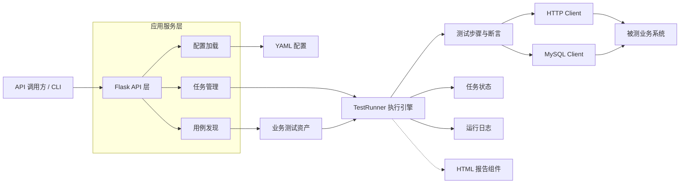

# AutoTestWeb

[](https://github.com/T-tang-tao/AutoTestWeb/actions/workflows/task-lifecycle-tests.yml)

基于 **Flask + Python** 的自动化测试工作台，用于组织测试用例、执行多步骤业务流程、查询任务状态并沉淀可复用的测试数据与接口能力。

项目将“测试资产、执行引擎、服务接口”分层，适合维护依赖登录态、数据库校验和多角色协作的复杂业务测试。

`Python 3.10+` · `Flask 3.x` · `REST API` · `YAML Configuration` · `HTML Report`

## 项目能力

- **测试用例自动发现**：扫描 `Business/<Module>/TestCases`，静态解析模块名与用例名。
- **多步骤测试编排**：测试用例通过 `setUp`、`defineSteps`、`tearDown` 管理完整生命周期。
- **业务测试分层**：API、Service、Data、BaseCase 与 TestCase 分离，复用登录、数据构造和流程校验能力。
- **任务化管理**：通过任务 ID 查询执行进度、用例状态和步骤级结果。
- **HTTP 与数据库能力**：内置请求客户端、Cookie 会话、重试和 MySQL 操作封装。
- **可读的结果输出**：结构化日志记录用例与步骤耗时，并提供 HTML 报告生成组件。
- **本地配置隔离**：真实环境、账号、Cookie 与数据库信息不进入版本库。

## 架构



### 执行链路

1. `ConfigLoader` 读取主配置，并加载测试环境与测试集。
2. API 创建任务，后台线程启动 `TestRunner`。
3. `TestRunner` 动态导入测试模块，完成用例实例化和步骤注册。
4. 依次执行 `setUp`、测试步骤和 `tearDown`，持续更新用例及步骤状态。
5. 调用方通过任务 ID 获取进度和结果，日志同步写入本地文件。

## 技术栈

| 分类 | 技术 |
| --- | --- |
| Web 服务 | Flask、Flask-CORS |
| 测试执行 | Python、`threading`、动态模块加载 |
| HTTP 测试 | Requests、Tenacity |
| 数据与配置 | MySQL、PyMySQL、YAML |
| 报告与日志 | HTML Template、Python Logging |
| 后台任务执行 | Python `threading`、进程内任务状态管理 |

## 快速开始

### 1. 准备环境

建议使用 Python 3.10 或更高版本。

```powershell
python -m venv .venv
.\.venv\Scripts\Activate.ps1
python -m pip install --upgrade pip
python -m pip install -r requirements.txt
```

macOS / Linux：

```bash
python3 -m venv .venv
source .venv/bin/activate
python -m pip install --upgrade pip
python -m pip install -r requirements.txt
```

### 2. 创建本地配置

```powershell
Copy-Item configs/main.example.yml configs/main.yml
Copy-Item configs/TestBed.example.yml configs/TestBed.yml
Copy-Item configs/TestSet.example.yml configs/TestSet.yml
```

macOS / Linux：

```bash
cp configs/main.example.yml configs/main.yml
cp configs/TestBed.example.yml configs/TestBed.yml
cp configs/TestSet.example.yml configs/TestSet.yml
```

将 `TestBed.yml` 中的地址和账号替换为本地测试环境信息。

### 3. 启动 API 服务

```powershell
python server.py
```

默认地址：`http://127.0.0.1:5000`

健康检查：

```powershell
Invoke-RestMethod http://127.0.0.1:5000/
```

### 4. 直接执行测试集

在配置完整且能访问被测环境后运行：

```powershell
python -m TestRunner.runner
```

## API

所有接口返回统一结构：

```json
{
  "status": "success",
  "message": "",
  "data": {}
}
```

| 方法 | 路径 | 说明 |
| --- | --- | --- |
| `GET` | `/` | 服务健康检查 |
| `GET` | `/getTestCases` | 获取自动发现的测试用例树 |
| `GET` | `/huixin/getConfig` | 获取当前测试环境配置 |
| `POST` | `/huixin/saveConfig` | 保存测试环境配置 |
| `POST` | `/huixin/executeTestCases` | 创建并执行测试任务 |
| `GET` | `/huixin/getTaskStatus/<task_id>` | 查询任务与步骤状态 |
| `POST` | `/huixin/createReport` | 启动业务报告创建任务 |

启动任务示例：

```json
{
  "assessment": "in_base",
  "params": {
    "example": "业务用例参数"
  }
}
```

服务会返回 `task_id` 和当前任务状态，随后可轮询：

```text
GET /huixin/getTaskStatus/<task_id>
```

任务状态字段为 `status`，可能值为 `pending`、`running`、`completed`、`failed` 或 `error`。其中 `completed` 表示测试套执行成功结束；测试套未通过时为 `failed`；任务初始化或执行过程中抛出未处理异常时为 `error`。查询响应包含创建/开始/结束时间、运行耗时（秒）、执行进度、失败摘要和测试用例详情。任务完成后会缓存可查询的结果快照并释放运行中的 `TestRunner` 引用；步骤详情会把内部方法/延迟调用转换为名称，避免结果对象保留用例实例或出现不可 JSON 序列化的 callable。

## 配置说明

### `main.yml`

主配置负责引用环境、测试集和业务代码目录：

```yaml
TestBedPath: ./TestBed.yml
TestSetPath: ./TestSet.yml
base_dir: ../Business

logger:
  level: INFO
  log_file: logs/app.log

reporting:
  report_path: reports
  format: html
```

相对路径以 `main.yml` 所在目录为基准。

### `TestBed.yml`

维护测试环境信息，包括：

- 被测系统地址与角色账号
- Ficus 登录信息
- MySQL 数据库连接
- 环境名称

模板仅包含占位值。真实配置应保持在本地。

### `TestSet.yml`

声明当前测试集包含的用例：

```yaml
test_cases:
  - path: "PrisonAssessmentSystem/TestCases/Assessment/InPrison/inmate_assessment_criminal_base_info_01.py"
    concurrent: false
    timeout: 60
    depends_on: []
```

当前主执行器按声明顺序串行执行用例，并实际读取 `path`。示例中的 `concurrent`、`timeout` 和 `depends_on` 是后续扩展字段，尚未在主执行流程中生效。

## 添加测试用例

### 1. 创建用例文件

在 `Business/<Module>/TestCases` 下新增 Python 文件。类名应与文件名一致：

```python
from TestRunner.core.Base import Base

case_name = "登录接口校验"


class login_api_01(Base):
    def defineSteps(self):
        self.def_step("调用登录接口", self.check_login)

    def check_login(self):
        # 在此调用业务 API，并使用 assert 校验结果
        ...
```

### 2. 注册到测试集

在 `configs/TestSet.yml` 中添加用例相对路径：

```yaml
test_cases:
  - path: "PrisonAssessmentSystem/TestCases/login_api_01.py"
```

### 3. 执行

通过 Flask API 创建任务，或运行：

```powershell
python -m TestRunner.runner
```

## 项目结构

```text
AutoTestWeb/
├─ app/
│  ├─ routes/               Flask 路由与蓝图
│  └─ services/             用例发现、任务管理和执行调度
├─ Business/
│  └─ <Module>/
│     ├─ API/               接口封装
│     ├─ Service/           业务服务层
│     ├─ Data/              测试数据工厂与流程数据
│     ├─ BaseCases/         可复用的测试基类
│     └─ TestCases/         业务测试用例
├─ TestRunner/
│  ├─ core/                 执行器、基类和断言工具
│  ├─ services/             HTTP 与数据库客户端
│  └─ extensions/           报告生成器与模板
├─ utils/                   配置、日志和响应工具
├─ configs/                 配置模板
├─ server.py                Flask 服务入口
└─ requirements.txt         Python 依赖
```

## 当前边界

- 当前任务状态保存在进程内，服务重启后不会保留历史任务，多个进程之间也不共享。
- 任务统一通过 `submit_test_task` 入口使用后台线程执行；状态由状态机维护，执行结果映射为 `completed`、`failed` 或 `error`。
- 已结束任务保留 1 小时；清理在提交新任务时触发，而不是定时执行。因此，若服务长时间空闲，过期记录可能暂时留在进程内。完成任务会保留结果快照并释放 `TestRunner` 引用。
- 项目提供 JSON API，不包含前端管理页面。
- 用例默认串行执行；并发、依赖和超时字段尚未接入主执行器。
- 业务示例依赖外部测试环境，未配置环境时无法独立跑通完整流程。

## 安全说明

- `configs/main*.yml`、`configs/TestBed*.yml` 和 `configs/TestSet*.yml` 已被 `.gitignore` 排除。
- `.env`、Cookie、日志、数据库导出和本地报告不会提交到 Git。
- 仓库只保留 `*.example.yml` 占位模板。
- 当前服务未实现鉴权与访问控制，请仅在受控的本地或内网开发环境中运行。
- 提交代码前建议检查账号、密码、Token、Cookie、真实业务标识和内网地址。

## CI 与质量检查

GitHub Actions 会在 Pull Request 和分支推送时运行，测试矩阵覆盖 Python 3.10、3.11 和 3.12。工作流执行以下步骤：

1. 安装 `requirements-dev.txt` 中的项目和开发依赖。
2. 编译任务执行、路由和状态机等关键模块，提前发现语法错误。
3. 使用 Ruff 检查关键模块及测试目录中的常见静态错误。
4. 运行 `pytest` 单元测试；测试使用 mock/fake 隔离真实业务系统，不要求个人账号、Cookie 或本地私有配置。

本地复现命令：

```bash
python -m pip install -r requirements-dev.txt
python -m py_compile TestRunner/core/TestRunner.py TestRunner/services/DataBaseClient.py app/__init__.py app/routes/base_routes.py app/routes/huixin_routes.py app/services/excute_testcases.py utils/ConfigLoader.py utils/LoggerManager.py utils/task_state.py
ruff check TestRunner/core/TestRunner.py TestRunner/services/DataBaseClient.py app/__init__.py app/routes/base_routes.py app/routes/huixin_routes.py app/services/excute_testcases.py utils/ConfigLoader.py utils/LoggerManager.py utils/task_state.py examples/mock_api tests --select E4,E7,E9,F --ignore F401
python -m pytest -q
```

当前 CI 以语法/基础静态错误和隔离单元测试为覆盖重点；尚未覆盖需要真实 MySQL、私有业务系统及生产级端到端数据的测试。

## Mock API 演示

不依赖真实业务服务或 MySQL，直接运行本地 Mock API 和 TestRunner 示例：

```bash
python -m pip install -r requirements-dev.txt
python examples/mock_api/run_demo.py
```

示例涵盖成功请求、业务错误码、请求参数校验失败和可控延迟，详细说明见 [Mock API 演示指南](docs/mock-api-demo.md)。

## Running tests

Install the development dependencies and run the isolated unit tests:

```bash
python -m pip install -r requirements-dev.txt
python -m pytest -q
```

The unit tests mock the TestRunner's external service dependencies and do not require local business credentials or a live test system.

Test case naming, step structure, parameter handling and result states are documented in [docs/test-case-guide.md](docs/test-case-guide.md).

Application factory and isolated test configuration are documented in [docs/app-factory.md](docs/app-factory.md).

The self-contained Mock API demo and one-command TestRunner run are documented in [docs/mock-api-demo.md](docs/mock-api-demo.md).

Database client transaction semantics, supported SQL helper conditions, and resource cleanup rules are documented in [docs/database-client.md](docs/database-client.md).

## License

本仓库目前未声明开源许可证。在获得明确授权前，代码仅用于查看与学习。
