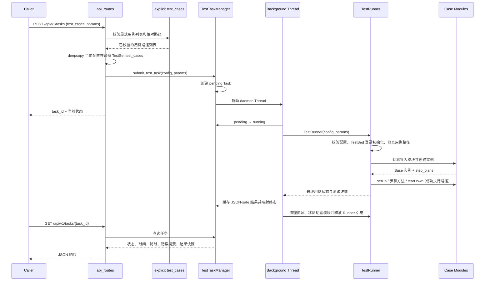

# AutoTestWeb 架构说明

本文以当前 `main` 的代码为准，描述已实现的模块边界、请求链路、错误传播、执行模型及其限制。目录里存在的类/文件不代表它们已接入所有线上请求路径；计划中的功能会单独标明。

## 1. 总体模块图

```mermaid
flowchart TD
    Client[HTTP Client / Caller] --> Flask[Flask Application Factory]
    Flask --> Routes[Blueprint Routes]
    Flask --> Config[ConfigLoader / In-memory Test Config]
    Routes --> GenericAPI[/api/v1: generic API]
    Routes --> LegacyAPI[/huixin: compatibility and business API]
    GenericAPI --> TaskAPI[Shared task service]
    LegacyAPI --> CaseMap[HuiXin assessment mapping]
    CaseMap --> TaskAPI
    TaskAPI --> Registry[Process-local TestTaskManager]
    Registry --> Worker[Background Thread]
    Worker --> Runner[TestRunner]
    Runner --> CaseLoader[Dynamic Case Loader]
    CaseLoader --> Base[Base / def_step]
    Runner --> Http[HttpClient / requests]
    Runner --> DB[DataBaseClient / PyMySQL]
    Runner --> Login[HuiXin_login / TestBed users]
    TaskAPI --> Snapshot[Cached JSON-safe result snapshot]
    Snapshot --> StatusAPI[GET /api/v1/tasks/{task_id}]
    Snapshot --> ReportAPI[GET /api/v1/tasks/{task_id}/report]
    Demo --> ReportGen[ReportGenerator]
    Demo[examples/mock_api] --> GenericAPI
```

### 模块职责

| 模块 | 当前责任 | 边界/说明 |
| --- | --- | --- |
| `app/__init__.py` | 创建 Flask app、载入/注入项目配置、按环境应用日志设置、注册蓝图 | 测试可注入内存配置；普通运行默认读取 `configs/main.yml` |
| `app/routes/base_routes.py` | 健康入口、兼容旧版 `/getTestCases` 用例列表 | 不负责启动任务；旧接口返回原有绝对路径 |
| `app/routes/api_routes.py` | 提供 `/api/v1` 的用例列表、TestBed 配置、任务提交、任务查询与 HTML 报告下载 | 用例路径以相对路径对外暴露；任务提交不依赖 HuiXin 评估代号 |
| `app/routes/huixin_routes.py` | 提供旧版 `/huixin` 兼容接口，以及 PrisonAssessmentSystem 专属的 `createReport` | 旧调用可继续使用；新客户端应优先使用版本化通用 API |
| `app/services/load_testsets.py` | 解析请求选择的测试集/用例信息 | 提供用例选择相关帮助函数，不执行已加载用例 |
| `app/services/excute_testcases.py` | 创建任务、维护进程内任务注册表、后台线程执行、更新终态和结果快照 | 通用执行服务不负责把业务评估代号映射为具体用例；任务状态只在当前进程中存在 |
| `app/services/huixin_testcases.py` | 将旧版 HuiXin `assessment` 代号映射为 PrisonAssessmentSystem 用例 | 只供 `/huixin/executeTestCases` 兼容入口使用；通用 API 直接接收用例列表 |
| `TestRunner/core/TestRunner.py` | 校验配置、动态加载用例、注册/运行步骤、汇总用例和步骤状态 | 主执行器按顺序执行用例；目前不是持久化任务队列 |
| `TestRunner/core/Base.py` | 定义用例基类与步骤注册结构 | `defineSteps()` 通过 `def_step()` 记录步骤，不立即运行步骤 |
| `TestRunner/services/HttpClient.py` | 对 requests.Session 的轻量封装，记录最近请求/响应，按方法提供超时默认值 | 当前 GET 会调用 `raise_for_status()`，POST 不会；网络错误由装饰器转为断言异常，这不是统一 HTTP 错误契约 |
| `TestRunner/services/DataBaseClient.py` | MySQL 查询、更新、受限辅助 SQL 校验、事务和游标管理 | 数据库单元测试用 fake connection/cursor；真实 schema 未由 CI 验证 |
| `utils/ConfigLoader.py` | 从主 YAML 加载 TestBed/TestSet 并解析路径 | 每次构造为独立对象，避免不同 app 共享配置状态 |
| `utils/LoggerManager.py` | 配置和提供共享 logging logger | 普通应用在工厂创建时应用项目日志配置；测试 app 不改共享日志配置 |
| `utils/response.py` | 把路由结果转成统一 JSON success/error envelope | 路由装饰器会捕获通用异常并返回 HTTP 500；此层不是本次数据库/HTTP 客户端错误模型的统一化 |
| `TestRunner/extensions/ReportGenerator.py` | 提供基于模板写出 HTML 报告的工具类 | 后台任务结束后生成 HTML；通用报告接口负责下载，任务状态接口仍返回 JSON |
| `examples/mock_api/` | 提供本地 HTTP 示例服务、5 个示例用例和一条命令的执行入口 | 专门用于隔离演示，不替代真实业务集成回归 |

## 2. 提交任务到查询结果的时序



旧版 `/huixin/executeTestCases` 会在兼容层把 `assessment` 代号转换成 PrisonAssessmentSystem 用例，再调用同一任务提交服务；新客户端直接传递 `test_cases` 数组，不依赖业务项目名称。配置、任务状态和报告也都有独立的通用路径；旧版 `/huixin/getConfig`、`saveConfig`、`getTaskStatus` 与 `getTaskReport` 仅作为过渡兼容入口。

### 状态与结果契约

任务级状态定义在 `utils/task_state.py`：

- `pending`：任务记录创建后、执行线程开始前。
- `running`：后台执行已启动。
- `completed`：TestRunner 将测试套映射为通过。
- `failed`：测试套结束但未全部通过。
- `error`：初始化或执行发生未处理异常。

任务响应在终态时保存 `status`、`progress`、`created_at`、`start_time`、`end_time`、`duration`、`error`、`config` 与 `test_instances`。步骤中的 callable/绑定方法被转成名称后再缓存，避免快照保留用例对象并确保响应可 JSON 序列化。

TestRunner 内部用例/步骤状态使用中文枚举（例如 `通过`、`失败`、`错误`、`跳过`）；它与任务级英文状态不是同一枚举，不应混用。

## 3. 配置和启动链路

```mermaid
flowchart LR
    Entry[server.py] --> Factory[create_app()]
    Factory --> Select{输入配置}
    Select -->|默认运行| Main[configs/main.yml]
    Main --> Bed[configs/TestBed.yml]
    Main --> Set[configs/TestSet.yml]
    Select -->|测试| Memory[project_config / fake loader]
    Bed --> AppExt[app.extensions config_loader]
    Set --> AppExt
    Memory --> AppExt
    AppExt --> Routes[Registered Blueprints]
```

- `server.py` 调用 `create_app()`；在普通启动流程中，工厂默认读取本地 `configs/main.yml`。
- `main.yml` 通过 `TestBedPath`、`TestSetPath` 和 `base_dir` 指向环境、测试集和业务代码目录，路径由 ConfigLoader 解析。
- 测试可调用 `create_app(test_config={"TESTING": True}, project_config=...)`，或者注入具备 `config/get_config/save_test_bed` 行为的 loader。测试模式只传 `TESTING` 时使用内存空配置，不会自动回退到个人本地 YAML。
- 路由通过 `current_app.extensions["config_loader"]` 查找配置，不再在路由模块导入时创建全局 loader。

详细说明见 [应用工厂与测试配置](app-factory.md)。

## 4. 执行、异常和资源边界

### 当前已实现

- 每个任务持有自己的深拷贝配置，避免同进程并发请求更改同一套 TestSet 列表。
- TaskManager 通过线程锁保护进程内任务注册表，Task 使用状态机限制非法状态转换。
- 任务在结束前缓存结果快照，再释放 TestRunner 引用；动态导入的用例模块以任务级唯一名称登记，执行结束后移除。
- TestRunner 清理阶段会尝试调用用例实例暴露的 `db.disconnect()`，随后清理用例实例与动态模块。
- 数据库客户端为游标使用上下文管理器；显式事务正常退出提交、异常退出尝试回滚；事务外单条更新成功后自动提交。
- 默认 CI 使用 mock/fake 隔离外部系统，并运行本地 Mock API 示例。

### 已知限制与后续演进方向

- **任务注册表是进程内存。** 进程重启后任务历史丢失，多个 worker 进程之间不共享状态；没有持久任务队列、重试或跨进程锁。
- **执行仍是后台线程 + 同步 Runner。** 每个任务在一个线程中串行执行测试用例；配置中的并发/超时提示没有形成通用的并发执行调度机制。
- **失败路径的 tearDown 行为需要修复。** 当前主流程在主体步骤断言失败或异常后不会自动调用 `tearDown()`，关键资源清理不能完全依赖它。它是已知缺陷，而不是受支持的保证。
- **取消只是不完整能力。** TestRunner 有停止信号接口，但 API 中的取消路由仍是注释代码，任务级取消没有正式启用。
- **报告边界要区分。** 任务状态端点返回 JSON 结果快照；`GET /api/v1/tasks/{task_id}/report` 下载后台生成的 HTML 执行报告。`/huixin/createReport` 仍是 PrisonAssessmentSystem 专属业务用例，与通用 HTML 报告下载不是一回事。
- **真实集成环境不在默认 CI 内。** CI 没启动真实 MySQL 或私有业务系统，也没有测试真实业务账号、权限和生产接近的数据清理。
- **部署安全行为未在本次文档任务中调整。** 当前服务的认证/访问控制能力有限；本文件不代表其适合直接暴露到公网。

优先演进建议：
1. 补齐 TestRunner 生命周期保证，确保失败/异常路径也执行清理，并增加验证数据库连接释放的回归测试。
2. 在明确的部署需求下评估持久化任务存储、跨进程协调、重试和取消协议，而不是继续扩充进程内任务字典。
3. 将真实数据库和业务系统的集成测试放入独立、获授权的环境，明示凭据、测试数据、恢复与清理责任。
4. 通用 API 已采用 `/api/v1` 资源路径；后续可在保持旧版 HuiXin 路由兼容的前提下逐步迁移客户端，并在完成迁移后单独规划旧路径弃用周期。

## 5. 从何处深入

- [测试用例编写指南](test-case-guide.md)：文件/类命名、步骤定义、参数和失败分类。
- [测试策略与质量保障](testing-strategy.md)：测试分层、数据隔离、CI 覆盖及尚未验证的内容。
- [Mock API 演示](mock-api-demo.md)：独立运行的 HTTP 示例与 TestRunner 端到端演示。
- [数据库客户端说明](database-client.md)：事务、SQL 辅助方法约束和资源清理。
- [应用工厂与测试配置](app-factory.md)：独立 app/config loader 的创建方法。
